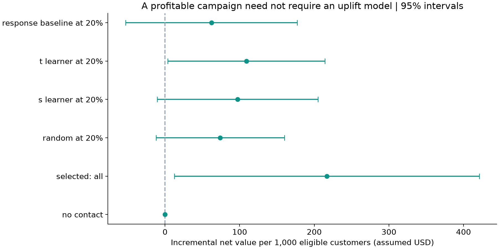
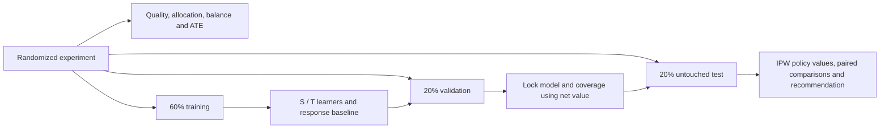
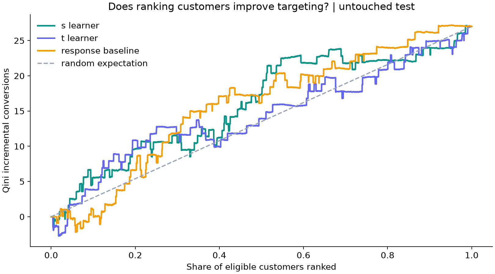

# Uplift Decision Lab

**From “did the campaign work?” to “who should receive the next one?”**

A reproducible case study connecting randomized experimentation, machine learning and a
marketing budget decision. Built for Product Analytics, Product Data Science and applied DS
conversations: the outcome is an evidence-based recommendation, even when ML adds no clear value.

| Product Analytics | Machine Learning | Business Decision |
| --- | --- | --- |
| Allocation checks, balance, data quality, ATE and uncertainty | Pre-treatment features, CatBoost S/T learners, response baseline, held-out Qini and AUUC | Reach selection, incremental net value, simple policy comparisons and risk |

## Two case studies

| Case | Decision | Added challenge | Report |
| --- | --- | --- | --- |
| Hillstrom email | Send to everyone or target a share? | Rare purchases, randomized experiment, simple economics | [Email report](reports/report.md) |
| X5 RetailHero contact | Can uplift ranking improve on RFM at a contact budget? | Receipt-level feature engineering, customer joins, source-design uncertainty | [contact report](reports/x5/report.md) |

X5 is a conditional policy benchmark: the available public sources do not provide a complete
assignment protocol. Its IPW evaluation explicitly assumes 50:50 random assignment; balance
and allocation checks do not verify this. Hillstrom retains its documented randomized design.
The cases use different outcome definitions and assumed currencies; their profits are not
directly comparable.

## The decision

Should a retailer send a promotional email to everyone, to a random share, or to customers
ranked by estimated incremental purchase probability? A good conversion model need not identify
customers whose behavior can be changed. A good uplift ranking need not justify its contact cost.

The [Hillstrom experiment](https://blog.minethatdata.com/2008/03/minethatdata-e-mail-analytics-and-data.html)
contains 64,000 customers randomized to Mens email, Womens email or no email, with outcomes over
two weeks. This MVP compares **Mens E-Mail versus No E-Mail**. Purchases are the primary outcome;
visits are secondary. It is a public historical case study, not a claim of running this experiment
or delivering results for an employer.

**Start with the [generated decision report](reports/report.md)** for actual results, uncertainty
and limitations. The report and charts are produced by the code, not hand-authored success claims.

### Default run: a simple strategy wins selection

| Evidence | Result |
| --- | --- |
| Purchase ATE, full binary experiment | +0.681 percentage points; approximate 95% CI +0.500 to +0.861 |
| Validation-selected policy | Contact all, 100% reach |
| Test incremental purchases per 1,000 eligible customers | 6.34 |
| Test net value per 1,000 at the assumed economics | $216.79; approximate 95% CI $12.49 to $421.09 |

The business takeaway is to take **contact-all into a prospective test** under these economics.
The validation comparison did not select ML targeting. This is not proof that no uplift model
could ever help; it is an honest outcome of this predeclared workflow.



## Reproduce

Requires Python 3.11 or 3.12 and [uv](https://docs.astral.sh/uv/). From a fresh clone:

```sh
git clone https://github.com/AndrienkoMic/uplift-decision-lab.git
cd uplift-decision-lab
uv sync --locked
uv run python run.py
uv run pytest
```

First run downloads the public data through `sklift.datasets.fetch_hillstrom`; subsequent runs
use `data/raw/`. The loader verifies the source file's checksum. Raw customer rows and local
prediction exports are excluded from Git. An original all-three-arm CSV can be used offline:

```sh
uv run python run.py --csv /path/to/hillstrom.csv
```

The default scenario assumes **$50 contribution per incremental purchase** and **$0.10 per
intended contact**. These values are explicit assumptions, not known Hillstrom economics.

```sh
uv run python run.py --value 20 --cost 0.50 --output reports/scenario_20
```

Use a separate output directory to preserve the default report. Changing economics changes
validation selection; repeatedly inspecting test results does not produce new independent evidence.
`reports/sensitivity.csv` changes economics while keeping the original selected policy fixed.

## How evidence becomes a decision



1. Check the original 1:1:1 assignment, missingness, outcome consistency and pre-treatment balance.
   Compute ATE with approximate confidence intervals. These checks flag issues; they do not prove
   valid randomization or complete logging.
2. Split by treatment assignment only. Train fixed-complexity CatBoost S/T learners and a
   control-response model. Features are explicitly whitelisted; visits, purchases, spend and
   assignment are never customer predictors. S-learner receives assignment only as its treatment
   indicator during training and counterfactual prediction.
3. On validation, compare no contact, contact all, random and model-ranked policies at predeclared
   coverage levels (10%, 20%, 30%, 50%, 70%, 100%). Lock the highest estimated incremental net value.
4. Evaluate that decision once on test using the known randomized assignment probability.
   Qini, normalized AUUC and Uplift@20% describe ranking; they do not choose another policy on test.
5. Report paired comparisons with no contact, contact all and random at the same selected reach.
   A negative or inconclusive ML result is a valid finding.

## The economic estimator

For contact policy `pi(X)`, randomized assignment `T`, purchase `Y`, assignment probability `p`:

```text
incremental conversions_i = pi(X_i) * [T_i Y_i / p - (1 - T_i) Y_i / (1 - p)]
incremental net_i         = value * incremental conversions_i - cost * pi(X_i)
```

Average over **all eligible holdout customers**, including those not targeted. This is a
Horvitz–Thompson / inverse probability weighted estimate versus never contacting anyone.
Here `p = 0.5` conditional on being in the two retained arms. It is not the original 1/3.
Profit is not the sum of model predictions. Contact costs apply to intended contacts, including
customers who would buy without email.

Intervals use empirical variance and a normal approximation. Paired comparisons use differences
of contributions for the same customers. They are conditional on fitted models and evaluated
masks, omit training and top-K threshold variation, and are exploratory rather than adjusted for
multiple comparisons. No claim of model superiority is based on ranking scores alone.



## Repository map

```text
notebooks/exploration.ipynb   guided exploration of generated evidence
src/data.py                  loading, validation, binary comparison and splits
src/experiment.py            allocation, balance and ATE
src/features.py              pre-treatment feature whitelist and transforms
src/models.py                CatBoost models through scikit-uplift
src/evaluation.py            normalized Qini/AUUC and Uplift@K
src/policy.py                coverage, IPW economics and validation selection
tests/                      experiment and business-estimator tests
reports/                    reproducible report, tables and figures
docs/interview_story.md      talking points and prompts for your real work experience
run.py                      one-command end-to-end analysis
uv.lock                     exact cross-platform dependency resolution
```

## X5 RetailHero: purchase history to contact targeting

The default run selects contact-all on validation. Held-out estimated net value is
1,359 RUB per 1,000 eligible customers, with an approximate 95% interval of −184 to 2,903 RUB.
The interval includes zero; positive economic value is not established. ML targeting was
not selected. These estimates depend on assumed random assignment and scenario economics.

```sh
uv run python run_x5.py
```

The first run downloads about 647 MiB across three verified files and scans the item-level
purchase history with DuckDB. It first forms receipts, then customer features; repeated
receipt totals are never summed across item rows. The aggregate cache makes later runs faster. The final model inputs are also saved locally as
data/x5/customer_features.parquet: one row per labeled customer, client ID plus 16 features,
without treatment or outcome columns.
Allow several GB of free disk for raw data, the environment and optional spill. DuckDB defaults
to a 2 GB aggregation memory limit; this does not cap total Python/CatBoost memory.

```sh
uv run python run_x5.py --memory-limit 1GB
uv run python run_x5.py --value 100 --cost 5 --output reports/x5_cost_5
```

Default scenario: **100 RUB assumed contribution per incremental purchase**, **2 RUB per intended
contact**. Models compete with an equal-weight RFM ranking whose percentile reference is fitted
on training customers only. Features include receipt recency/frequency, past spend, mean basket,
recent activity and store breadth; customer identifiers and post-treatment outcomes are excluded.
No post-treatment basket margin is available; past spend never substitutes for future profit.

`run_x5.py`, `src/x5.py`, [the X5 notebook](notebooks/x5_exploration.ipynb),
and [design notes](docs/x5_design.md) keep this second case separate from the email report.
Local customer-level outputs under `reports/x5/` stay outside Git; summary tables and charts
are published. Data/source SHA-256 values, feature anchor, model settings and package versions
are recorded in the report manifest.

The labeled 200,039-customer sample is split into train/validation/test. The competition's
unlabeled test is not used for policy-value claims. Lapsed/frequent segment thresholds use
training features, with exploratory outcome differences evaluated on test. The source documents
purchase history before communication but does not give a verifiable campaign cutoff or exact
outcome-window duration; neither is invented by this project.

## Verification

```sh
uv run ruff check .
uv run pytest
```

Tests cover known effects, broken allocation, disjoint splits, leakage invariance, fixed contact
budgets, policies that avoid harm, known IPW value, paired differences and choosing no contact
when contacting costs money. CI runs these without downloading data. The full real-data report
is generated separately; synthetic fixtures never stand in for experimental evidence.

## What this case study cannot establish

Purchase is rare, so segmentation can be noisy. The extract cannot verify unique customers,
email delivery, attrition or interference. Historic retailer results may not transfer to a new
market. Purchase contribution and contact cost are scenario assumptions; observed spend is
revenue, not margin. A single retrospective holdout does not replace a prospective policy test.

The next business step is a preregistered test of the chosen rule against a simple operational
comparator, with fixed reach, a meaningful minimum effect and contribution-margin guardrails.
Multi-treatment targeting and doubly robust estimators are useful later extensions, not MVP scope.

## Sources and license

- [Original MineThatData challenge](https://blog.minethatdata.com/2008/03/minethatdata-e-mail-analytics-and-data.html)
- [Hillstrom data and field definitions](https://www.uplift-modeling.com/en/latest/api/datasets/fetch_hillstrom.html)
- [scikit-uplift model and metric documentation](https://www.uplift-modeling.com/en/latest/)

Code: [MIT](LICENSE). Data remain subject to their original source terms and are downloaded
separately; this repository's code license does not relicense them.
