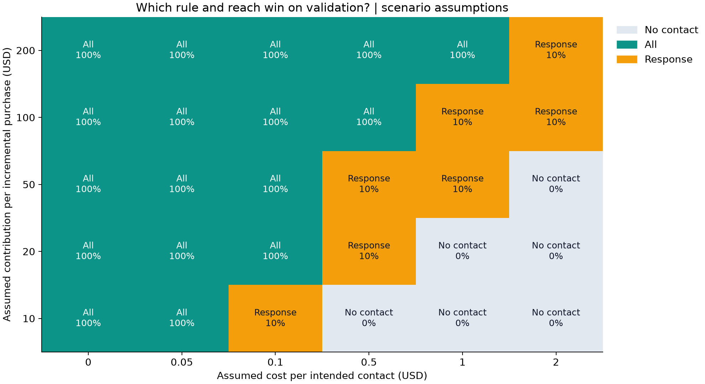
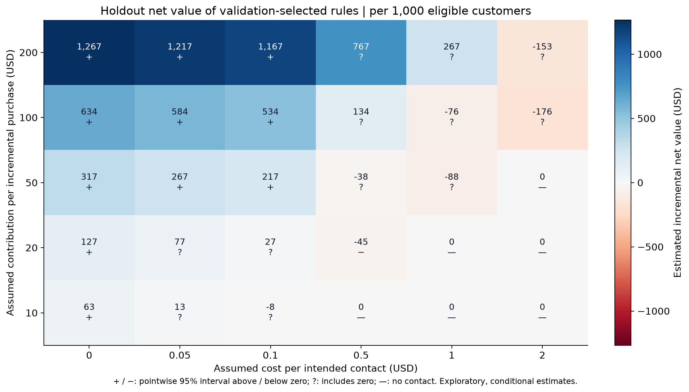

# Economic decision map (USD)

**Default scenario:** contribution 50, cost 0.1; validation chooses
all at 100% requested reach. Holdout net estimate:
216.79 USD per 1,000 eligible customers;
approximate 95% interval [12.49,
421.09]. This does not establish superiority to another policy.

## When does the decision change?
Models fit train once. Each cell chooses the highest estimated net value on validation
from the same fixed policy/coverage candidates, then evaluates that locked rule on test.
The selection map uses no test outcomes. Costs apply to every intended contact;
contribution applies to an incremental purchase, not historical spend or baseline conversion.

## What does the holdout support?

Each cell shows net value per 1,000 **eligible** customers, including nonrecipients.
`+`/`−` indicate pointwise intervals wholly above/below zero; `?` includes zero;
`—` is the zero-valued no-contact rule. They are not multiplicity-adjusted deployment signals.
The full table is [economics_scenarios.csv](economics_scenarios.csv): confidence endpoints
`test_ci_low`/`test_ci_high` use USD per eligible customer (multiply by 1,000 for the chart).

## Break-even contact costs
For a fixed rule with positive reach:
`max_contact_cost = contribution × validation_incremental_purchases / validation_coverage`.
Below this boundary its validation point estimate is positive relative to no contact.
A zero/negative boundary provides no positive-value region at nonnegative costs.
The boundary is a point estimate, not a conservative spending limit or model prediction.
[break_even.csv](break_even.csv) exports every candidate at contribution 50 USD.

## Evidence boundary and reproducibility
- This grid was specified for an exploratory extension after the original holdout was inspected.
  It is not a new independent confirmatory test. Do not choose attractive economics or a new
  policy from the test heatmap and claim unbiased confirmation.
- All scenarios reuse the same customers and trained models. Their estimates are correlated;
  they are alternative assumptions, not separate experiments.
- Normal intervals condition on fitted models and policy masks. They omit training, threshold
  and validation-selection uncertainty and do not adjust for multiple comparisons.
- Assignment assumptions are inherited from the parent report: Hillstrom uses known p=0.5
  within the retained randomized arms; X5 assumes p=0.5 random assignment with an unverified
  full assignment protocol. A heatmap does not establish causality or future-time validity.
- Costs and purchase contribution are scenario assumptions. Confirm margin, delivery,
  assignment documentation and contact guardrails before a prospective policy test.
- Running the parent runner regenerates this report, both charts, tables and
  [manifest](economics_manifest.json), which records the grid and validation-candidate hashes.
