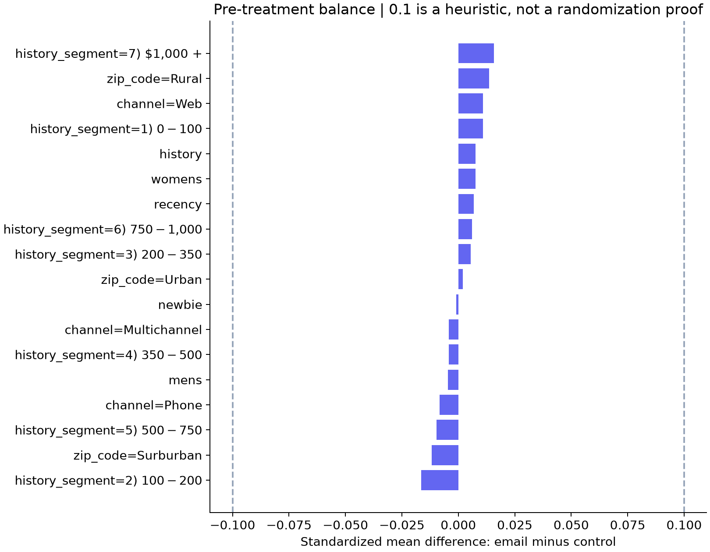

# Uplift Decision Lab — experiment to decision

**Decision:** Use contact-all as the candidate for a prospective campaign test under these economics. Validation selected this simple strategy and held-out net value versus no contact is positive with an approximate 95% interval above zero. ML targeting was not selected. Contact-all and random at 100% are the same rule, so their zero paired differences are identities, not failed superiority tests.

## Business question
Should a retailer send the Mens email to everyone, no one, a random share, or customers ranked
by a model? Primary outcome: purchase within two weeks. Website visits are a secondary diagnostic.
The Womens arm is excluded from modeling, but retained in the original allocation check.

## Experiment evidence
- Original rows: 64,000; binary comparison: 42,613.
- Original 1:1:1 sample-ratio mismatch p-value: 0.9037.
- Missing required cells: 0; duplicate profiles:
  7,791. Identical profiles are not identified customers.
- Purchase ATE (all eligible binary rows, descriptive experiment estimate):
  0.681 percentage points,
  approximate 95% CI [0.500, 0.861].
- Control purchase rate 0.57%; email 1.25%.
- Maximum absolute pre-treatment SMD: 0.016.
  SRM and balance checks can flag issues; neither proves correct assignment or absence of bias.

## Locked decision and economics
Train/validation/test sizes: {'train': 25567, 'validation': 8523, 'test': 8523}. Treatment-only stratification; seed
42. Models see only training outcomes. Model and reach are chosen on
validation net value, including no-contact, contact-all and random alternatives. No test tuning.
Selected: **all**, requested coverage **100%**.

Assumed contribution per incremental purchase: **$50.00**;
contact cost: **$0.10**. These are scenario inputs, not measured margin.
Break-even average conversion uplift among contacted users is cost/value (if value > 0).
No conversion probability is multiplied by observed post-treatment spend.

For each untouched test customer, use randomized assignment T, purchase Y, and policy pi(X):

`incremental_net_i = pi(X_i) * [value * (T_i Y_i / 0.5 - (1-T_i) Y_i / 0.5) - cost]`

The mean estimates incremental value versus no contact per **eligible customer**. Multiply
by 1,000 for a comparable audience. Conditional assignment probability is 0.5 because the
original three-arm experiment is filtered to Mens versus no email. It is not 1/3 or the observed
sample fraction. Top-K uses only pre-treatment scores and deterministic random tie-breaking.

## Held-out policy values
| label | coverage | incremental_conversions_per_1000 | net_per_1000 | ci_low | ci_high |
| --- | --- | --- | --- | --- | --- |
| no contact | 0.0000 | 0.0000 | 0.0000 | 0.0000 | 0.0000 |
| contact all | 1.0000 | 6.3358 | 216.7899 | 0.0125 | 0.4211 |
| random same coverage | 1.0000 | 6.3358 | 216.7899 | 0.0125 | 0.4211 |
| selected: all | 1.0000 | 6.3358 | 216.7899 | 0.0125 | 0.4211 |
| random at 20% | 0.1999 | 1.8773 | 73.8707 | -0.0121 | 0.1599 |
| s_learner at 20% | 0.1999 | 2.3466 | 97.3366 | -0.0105 | 0.2051 |
| t_learner at 20% | 0.1999 | 2.5813 | 109.0696 | 0.0038 | 0.2144 |
| response_baseline at 20% | 0.1999 | 1.6426 | 62.1377 | -0.0528 | 0.1771 |

`ci_low` and `ci_high` above are net value per eligible customer. Intervals use the empirical
variance of IPW contributions and a normal approximation. Comparisons use paired differences
on the same customers, not overlap of separate confidence intervals.

Paired selected-minus-comparator results (net value per eligible customer):
| comparator | net_per_customer | ci_low | ci_high |
| --- | --- | --- | --- |
| no contact | 0.2168 | 0.0125 | 0.4211 |
| contact all | 0.0000 | 0.0000 | 0.0000 |
| random same coverage | 0.0000 | 0.0000 | 0.0000 |

## Held-out ranking diagnostics
| model | qini_auc_normalized | auuc_normalized | uplift_at_20pct |
| --- | --- | --- | --- |
| s_learner | 0.0613 | 0.0021 | 0.0110 |
| t_learner | 0.0244 | 0.0008 | 0.0126 |
| response_baseline | 0.0581 | 0.0022 | 0.0076 |

Qini AUC and AUUC are **normalized scikit-uplift scores**, not dollar values or raw areas.
Uplift@20% is the treatment-minus-control purchase rate inside the top 20% (`overall` strategy).
These are descriptive diagnostics for all predeclared models; they do not reselect the policy.
The response baseline ranks by purchase probability learned on controls; it is not causal uplift.
Qini sorts tied scores as defined by sklift; the policy layer breaks ties explicitly.

## Limits and next experiment
- Purchases are rare. Model differences and normal intervals may be unstable; one split cannot
  establish general superiority. Confidence intervals are approximate, conditional on fitted
  models and fixed evaluated masks; they omit training variation and top-K threshold variation.
- Validation selection is optimistic there; test comparisons are exploratory, not multiplicity
  adjusted. Inspecting diagnostic test tables does not authorize trying another policy on test.
- The public extract cannot verify user identity, delivery, attrition, interference or logging
  completeness. Intent-to-treat assignment effects are not effects of actually opening an email.
- The dataset is an old retailer experiment. Customer mix, product offer, contact fatigue and
  opportunity costs may differ today. One campaign cannot estimate long-term customer value.
- A scalar conversion margin ignores basket heterogeneity. The spend ATE is reported separately
  in `summary.json`; revenue is not profit. Contact cost is charged to every intended recipient.
- Next: preregister the chosen policy versus a simple operational comparator, fix budget and
  decision rule, power the experiment using a business-relevant minimum effect, monitor delivery
  and guardrails, and measure net contribution prospectively.

## Reproduce and audit
Run `uv sync --locked` then `uv run python run.py`. Machine-readable outputs include
`summary.json`, `ranking_metrics.csv`, `policies_test.csv`, `policies_validation.csv`,
`balance.csv`, `sensitivity.csv`, local split IDs and local holdout predictions.
The manifest records data SHA-256, configuration, feature names and package versions.
Changing costs/values reruns a new scenario and validation selection; it is not an additional
independent test. Synthetic test fixtures are used only in unit tests, never in this report.

Sources: [Hillstrom original challenge](https://blog.minethatdata.com/2008/03/minethatdata-e-mail-analytics-and-data.html),
[dataset documentation](https://www.uplift-modeling.com/en/latest/api/datasets/fetch_hillstrom.html),
[scikit-uplift metrics](https://www.uplift-modeling.com/en/latest/api/metrics/index.html).
