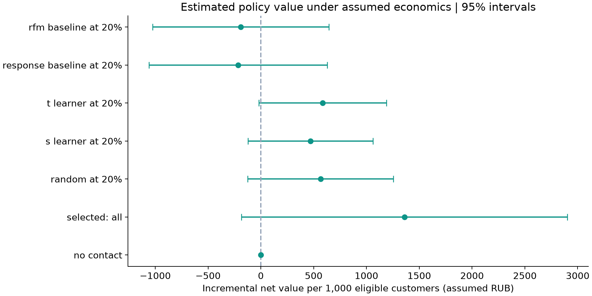
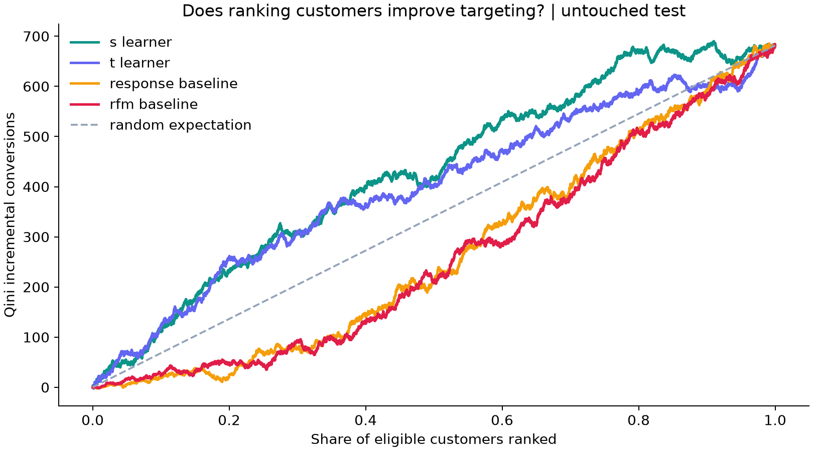
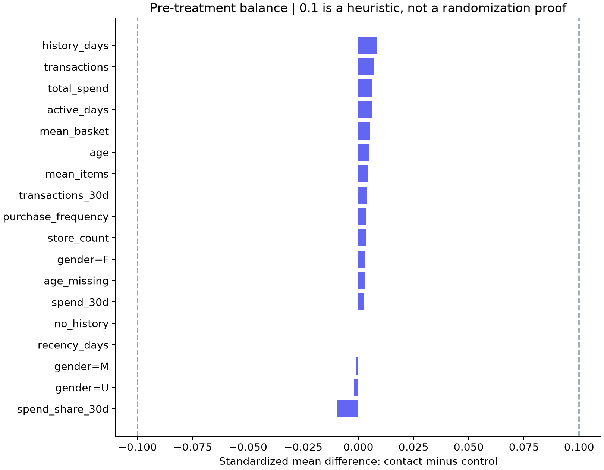

# X5 RetailHero — purchase propensity or incremental response?

**Locked candidate:** all at 100% requested reach,
selected on validation net value. Evaluate this candidate in a new prospective randomized test
before an operational rollout. No guaranteed uplift-model advantage is assumed.

Held-out net value: **1359.33 RUB per 1,000 eligible customers**;
approximate 95% CI [-184.18, 2902.84]. The holdout interval includes zero: positive net value is not established.

**Evidence boundary:** the public sources describe treatment/control labels and approximately
50% treatment allocation, but do not supply a complete assignment protocol. Our policy estimator
assumes random assignment with p=0.5, no interference and complete outcome logging. Balance and
allocation diagnostics cannot validate those assumptions. The policy values below are conditional
benchmark estimates, not independently established causal profit or a deployment recommendation.

## Business question
Can contact targeting improve incremental purchases at a fixed contact budget compared with contact
all, random outreach, a control-response model and a familiar RFM customer ranking?
`target` is purchase after communication according to the source. The extract does not establish
the exact outcome-window duration, so this report does not reuse Hillstrom's two-week window.

Scenario inputs: **100.00 RUB contribution per incremental purchase** and
**2.00 RUB per intended contact**. These are assumed economics,
not measured X5 margin.
The cost is charged to each intended recipient; we do not multiply uplift by past customer spend.

## Data and checks
- Labeled customers: 200,039; one row per customer after joins.
- Aggregated receipts: 4,024,949 in the labeled cohort.
- Provided purchase history: 2018-11-21 21:02:33 to
  2019-03-18 23:19:28.
- Feature reference: 2019-03-19 00:00:00; day after latest supplied
  pre-communication receipt. This is a feature anchor, not an invented campaign date.
- Customers with no history: 0; missing or
  implausible ages (outside 14–100): 883.
- Conditional 50:50 allocation check p-value: 0.8633.
- Maximum absolute pre-treatment SMD: 0.009.
- Full-cohort purchase-rate difference: 3.323 percentage points;
  approximate 95% CI [2.898, 3.748].
- Control purchase rate 60.33%; contact group 63.65%.
  These are outcome rates, not incremental response rates.

## Features and baselines
Raw purchase rows are item lines. DuckDB first groups by `(client_id, transaction_id)` and takes
the repeated `purchase_sum` once, checking consistency. Item quantities are summed. Customer
features include recency, receipt frequency, total historical spend, mean basket, active days,
recent 30-day activity, items per receipt and store breadth, plus age and gender. Client ID,
treatment and the target never enter the model. Source clients' registration/redemption timestamps
and product-category features are excluded; no product-category table is loaded in this MVP.

RFM = equal-weight average of favorable recency, frequency and monetary percentiles relative to
**training customers only**. It is a high-value customer heuristic, not an uplift estimate.
The response baseline estimates purchase propensity on controls. CatBoost S/T learners retain
the same fixed complexity as Hillstrom. Categorical input is `gender`; missing numerics follow
explicit sentinel/zero rules with missingness flags, without fitted holdout imputation.

## Selection and held-out evaluation
60/20/20 split by customer, stratified only by assignment; seed 42.
Sizes: {'train': 120023, 'validation': 40008, 'test': 40008}. Train fits models and RFM percentiles; validation chooses one
model/rule and coverage from the predeclared grid [0.1, 0.2, 0.3, 0.5, 0.7, 1.0]; test never chooses another policy.

`net_i = pi(X_i) * [value * (T_i Y_i / 0.5 - (1-T_i) Y_i / 0.5) - cost]`

Values are relative to no contact per **eligible** customer, not per contacted customer.
Approximate 95% intervals use empirical contribution variance. Paired differences use the same
test customers; no conclusions are drawn from overlap of separate intervals.

| label | coverage | incremental_conversions_per_1000 | net_per_1000 | ci_low | ci_high |
| --- | --- | --- | --- | --- | --- |
| no contact | 0.0000 | 0.0000 | 0.0000 | 0.0000 | 0.0000 |
| contact all | 1.0000 | 33.5933 | 1359.3281 | -0.1842 | 2.9028 |
| random same coverage | 1.0000 | 33.5933 | 1359.3281 | -0.1842 | 2.9028 |
| RFM same coverage | 1.0000 | 33.5933 | 1359.3281 | -0.1842 | 2.9028 |
| selected: all | 1.0000 | 33.5933 | 1359.3281 | -0.1842 | 2.9028 |
| random at 20% | 0.2000 | 9.6481 | 564.8370 | -0.1236 | 1.2533 |
| s_learner at 20% | 0.2000 | 8.6983 | 469.8560 | -0.1225 | 1.0622 |
| t_learner at 20% | 0.2000 | 9.8480 | 584.8330 | -0.0191 | 1.1888 |
| response_baseline at 20% | 0.2000 | 1.8496 | -215.0070 | -1.0592 | 0.6292 |
| rfm_baseline at 20% | 0.2000 | 2.0996 | -190.0120 | -1.0238 | 0.6438 |

`net_per_1000` is RUB per 1,000 eligible customers.
`ci_low`/`ci_high` are RUB per eligible customer.
Rows at 20% are predeclared diagnostics, not a second test-based policy selection.
At 100% reach all rankings select the same customers. The chart merges identical selected rows.

Paired selected-minus-comparator estimates at the selected coverage:
| comparator | net_per_customer | ci_low | ci_high |
| --- | --- | --- | --- |
| no contact | 1.3593 | -0.1842 | 2.9028 |
| contact all | 0.0000 | 0.0000 | 0.0000 |
| random same coverage | 0.0000 | 0.0000 | 0.0000 |
| RFM same coverage | 0.0000 | 0.0000 | 0.0000 |

## Ranking diagnostics
| model | qini_auc_normalized | auuc_normalized | uplift_at_20pct |
| --- | --- | --- | --- |
| s_learner | 0.0100 | 0.0158 | 0.0589 |
| t_learner | 0.0066 | 0.0106 | 0.0655 |
| response_baseline | -0.0086 | -0.0134 | 0.0058 |
| rfm_baseline | -0.0094 | -0.0148 | 0.0121 |

Qini/AUUC are normalized scikit-uplift scores. Uplift@20% is the treatment-minus-control purchase
rate inside the top 20% (`overall` strategy). These metrics are not proof of economic benefit.
RFM and the response model are rankings, not estimates of a causal treatment effect.

## Business segments, fixed using training data
Segments use the training median of receipt count and training 75th percentile of recency.
“Lapsed” takes priority, then “frequent”, then “other”. They are heuristic labels, not a claim
that a customer has churned. Segment differences below are exploratory holdout diagnostics;
they do not alter the locked policy. Feature thresholds never use test outcomes.

| segment | n_control | n_treatment | ate | ci_low | ci_high |
| --- | --- | --- | --- | --- | --- |
| lapsed | 4764 | 4684 | 0.0470 | 0.0273 | 0.0668 |
| frequent | 8833 | 9008 | 0.0131 | 0.0019 | 0.0242 |
| other | 6415 | 6304 | 0.0434 | 0.0260 | 0.0608 |

## Limitations and next decision
- Assignment protocol is unverified in the available source documentation. A balanced treatment
  count is not evidence of exchangeability; observational targeting could confound these estimates.
- Costs, purchase contribution, delivery rate and opportunity costs are assumptions. Historical
  spend is not future margin. There is no post-treatment basket/margin outcome here.
- The normal intervals condition on fitted models and evaluated masks. They omit model-training
  and top-K threshold variation. Diagnostic comparisons and segments are not multiplicity-adjusted.
- High baseline purchase rates make IPW noisy. Frequent buyers may buy without contact.
  Strong predictive accuracy is not evidence of an incremental marketing opportunity.
- The source documents the purchase history as pre-communication. The extract alone cannot verify
  the true campaign cutoff, outcome window, identity completeness or delivery; no temporal
  generalization claim is made from this random customer split.
- Next: obtain/confirm assignment documentation, then prospectively test the locked candidate
  against the simplest operational alternative at a fixed budget with margin and contact guardrails.

## Reproduce and audit
`uv sync --locked` then `uv run python run_x5.py`. First run downloads about 647 MiB of compressed
data and aggregates it with a 2 GB DuckDB memory limit plus disk spill; cached runs reuse verified
customer aggregates. `--memory-limit` changes aggregation memory, not total Python process memory.
Raw data, customer features, split IDs and prediction exports stay local and are excluded from Git.
`summary.json` records source SHA-256 values, cache schema, features, configuration and versions.

Sources: [organizer data page](https://ods.ai/competitions/x5-retailhero-uplift-modeling/data),
[scikit-uplift dataset documentation](https://www.uplift-modeling.com/en/latest/api/datasets/fetch_x5.html),
[loader with source checksums](https://github.com/maks-sh/scikit-uplift/blob/master/sklift/datasets/datasets.py).

## Economic scenarios

See the [economic decision map](economics_report.md) for validation-selected rules across assumed contact costs and purchase contributions, holdout uncertainty and break-even costs. This is an exploratory extension after original holdout inspection.
